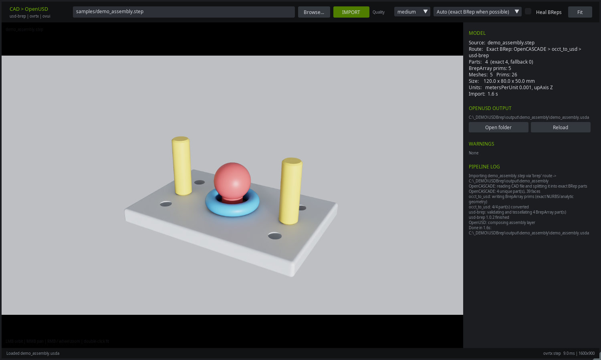

# CAD → OpenUSD viewer (usd-brep · ovrtx · ovui)

A small local Windows tool that imports CAD files (STEP, IGES, OCCT BREP, SMLib, JT, Parasolid,
CATIA, SolidWorks, …) into **OpenUSD** and shows them in an interactive **RTX viewport**.

- **Exact BRep path** — STEP / IGES / `.brep` keep their NURBS / analytic geometry as
  [usd-brep](https://github.com/NVIDIA-Omniverse/usd-brep) `BrepArray` prims; usd-brep validates
  (and optionally heals) them and tessellates them into `UsdGeomMesh` for display.
- **Mesh path** — every other CAD format goes through NVIDIA's
  [`usd-convert-cad`](https://pypi.org/project/usd-convert-cad/) (HOOPS-based, tessellated output).
- **Viewer** — [ovui](https://pypi.org/project/ovui/) window, [ovrtx](https://pypi.org/project/ovrtx/)
  renderer attached to an [ovstage](https://pypi.org/project/ovstage/) stage; orbit / pan / zoom.



This tool was built in one Claude Code session. [SESSION.md](SESSION.md) lists the prompts and the steps taken.

## Setup (once)

Requirements: Windows x64, NVIDIA RTX GPU + current driver, [uv](https://docs.astral.sh/uv/), git,
Visual Studio Build Tools with the C++ toolset and Windows SDK (only needed to build `occt_to_usd`).

```bat
setup.bat
```

This creates `.venv` (Python 3.12, which usd-brep and usd-convert-cad require), installs the pinned
packages from `pyproject.toml`, clones usd-brep into `third_party/usd-brep`, and builds its
`occt_to_usd` converter (`third_party\build_occt_to_usd.bat`; log in `third_party\build.log`).

> `occt_to_usd` is not part of the usd-brep PyPI wheel; it is built from source. usd-brep pins
> MSVC v142 (`msbuild.vs_version = "vs2019"`). `setup.bat` switches that to vswhere discovery, and the
> build script passes `PlatformToolset=v145` to MSBuild so the installed VS 18 Build Tools are used.
> If you have VS 2019/2022 instead, edit the toolset in `third_party\build_occt_to_usd.bat`.

## Use

```bat
run.bat                               & rem open the viewer
run.bat path\to\part.step             & rem open and import a file immediately
```

Type or **Browse…** to a file, choose the **Export** format (**USDC** binary crate, the default, or
**USDA** text), **Quality** (tessellation tolerance), the **route** (auto = exact BRep when possible, or
force mesh-only), optionally **Heal BReps**, then **IMPORT**.
Mouse: **LMB** orbit · **MMB** pan · **RMB drag / wheel** zoom · **double-click / Fit** frame the model.

The first time the renderer runs in a new configuration, RTX compiles its shaders. This can take
a minute or two, and the status bar says so. Later starts take a few seconds.

Headless tools (same pipeline):

```bat
.venv\Scripts\python -m cadview.pipeline samples\demo_assembly.step [--quality fine] [--heal] [--route mesh] [--format usda]
.venv\Scripts\python -m cadview.snapshot samples\demo_assembly.step out.png --size 1280x720
.venv\Scripts\python tools\make_sample_step.py samples\demo_assembly.step   & rem regenerate the sample
```

## Output

Each import writes `output\<file-stem>_<ext>\`, e.g. `output\gearbox_step\` (override the root with `CADVIEW_OUTPUT`):

Every USD file an import writes uses the selected export format: `.usdc` (default) or `.usda`.
The table uses `.usdc`.

| File | Content |
|---|---|
| `<stem>.usdc` | Assembly layer: Xform hierarchy, CAD transforms and names, colours as `UsdPreviewSurface`, `metersPerUnit = 0.001`, `upAxis = Z`. Each part is referenced from `parts/` |
| `parts/pNNN_brep.usdc` | Exact geometry: usd-brep `BrepArray` written by `occt_to_usd` |
| `parts/pNNN.usdc` | usd-brep `tessellate_file` output: the `BrepArray` **plus** a `UsdGeomMesh` per BRep |
| `parts/pNNN.brep` | The part as an OpenCASCADE BRep (intermediate) |
| `occt_manifest.json`, `import_report.json` | Assembly tree, per-part status, warnings, timings |

Shared parts are written once and referenced per instance. Part prims carry
`customData` (`cadview:geometry` = `usd-brep` or `occt-fallback`, `cadview:exactBrep`).

## Routes and formats

| Input | Route |
|---|---|
| `.step .stp .iges .igs` | OpenCASCADE XCAF (assembly, names, colours) → per-part `.brep` → **`occt_to_usd`** → `BrepArray` → **usd-brep** validate / heal / tessellate → assembly USD |
| `.brep` (OpenCASCADE) | same, one part |
| `.smb` (SMLib) | **usd-brep** `read_brep_from_file` → `export_brep` (`BrepArray`) → tessellate |
| `.usd .usda .usdc` with `BrepArray` prims | **usd-brep** `tessellate_file` → viewed |
| other `.usd*` | viewed as is |
| `.jt .x_t .x_b .catpart .catproduct .sldprt .sldasm .prt .asm .ipt .iam .3dxml .sat .3dm .ifc .dwg .rvt .stl .obj .fbx .gltf` … | **usd-convert-cad** (HOOPS) → tessellated `UsdGeomMesh` |

Fallbacks are listed under *Warnings* in the UI and in `import_report.json`. Nothing fails silently:

- If one part fails on the usd-brep path (converter or tessellation), the tool meshes that part
  with OpenCASCADE instead.
- If OpenCASCADE cannot read a STEP/IGES file at all (for example a 1990s STEP file without product
  structure), the whole file goes through usd-convert-cad instead.
- If usd-convert-cad produces nothing visible, the tool retries it, first including hidden CAD
  elements (`--filter-style none --load-hidden`), then also converting curves (`--convert-curves`)
  for wireframe-only DWG/DGN files. Curves get a line width relative to the model size.

**Non-triangulated JT:** the B-rep in a JT file (XT/Parasolid B-rep segments) is read by the HOOPS
converter in `usd-convert-cad`, which writes tessellated meshes only. Neither OpenCASCADE nor usd-brep
reads JT, so JT has **no exact-BRep path** in this tool. Its geometry arrives as meshes, at the
tessellation level set by **Quality** (`--tess-lod`). To keep exact geometry, export the model
from the CAD system as STEP (or IGES) and import that. Parasolid `.x_t` / `.x_b` also go
through HOOPS and arrive as meshes.

## Tested formats

`tools/fetch_web_samples.py` downloads one public sample per format into `samples/web/`; the URLs are
listed in `samples/web/sources.json`. `tools/format_matrix.py` imports and renders each one and writes
`output/format_matrix/` (`report.md`, `contact_sheet.png`, one PNG per format).

Latest run (2026-11-20): **33 of 37 samples imported and rendered.**

| Result | Formats |
|---|---|
| Exact BRep via usd-brep | `.stp` assembly, `.igs` (21 of 22 surfaces; 1 trimmed surface fell back to an OpenCASCADE mesh), `.brep`, `.smb`, `.usda` with `BrepArray` |
| Meshes via usd-convert-cad | `.step` (1995 file, automatic fallback), `.jt`, `.x_t`, `.xmt_txt`, `.x_b`, `.sat`, `.CATPart`, `.CATProduct`, `.cgr`, `.SLDPRT`, NX `.prt`, `.ipt`, `.iam`, `.3dm`, `.dxf`, `.rfa`, `.rvt` (hidden elements included), `.ifc`, `.ifczip`, `.stl`, `.obj`, `.fbx`, `.dae`, `.3ds`, `.3mf`, `.glb` |
| Wireframe (BasisCurves) | `.dwg`, `.dgn` (both samples are 1990s wireframe models) |
| Failed | Creo/Pro/E `.prt` (the sample is Pro/E V18, `A3D_LOAD_FILE_TOO_OLD`); Solid Edge `.par` (2 samples: converted but empty) and `.psm` (`A3D_LOAD_INVALID_FILE_FORMAT`); `.3dxml` (the sample, a 2009 quad, produced no geometry) |
| No sample found | ACIS binary `.sab`, Solid Edge `.pwd`, SolidWorks `.sldasm`, `.ifczip` from a real source (the tested one was zipped from the IFC sample) |

The failures belong to these particular samples. Other Creo, Solid Edge or 3D XML files may work.

## Architecture

Several OpenUSD builds live in this environment: usd-brep's bundled USD 25.11, usd-convert-cad's
`pxr` 25.11, and ovrtx/ovstage's own runtime. They must never load into the same process, so each
one runs in a separate process:

```
viewer process (ovui + ovrtx + ovstage)           worker processes (python -m cadview.workers.*)
 ├─ app.py          ovui window, input, panels     ├─ occt_export.py   OpenCASCADE only
 ├─ renderer_runtime.py  render thread: owns        ├─ brep_tess.py     usd-brep only
 │     Renderer + Stage; write@N → floor → step(N)  ├─ usd_compose.py   usd-convert-cad's pxr only
 ├─ camera.py       orbit camera (omni:xform)      ├─ occt_to_usd.exe  usd-brep C++ (source build)
 └─ pipeline.py     orchestrates the workers ────► └─ usd-convert-cad  HOOPS CLI
```

- The user's USD is never modified. The viewer populates OVStage from a session root layer that
  sublayers the asset and adds the camera, RenderProduct, `LdrColor` RenderVar and, when the asset
  has no lights, a camera-mounted headlight plus a dome fill.
- Camera moves are `omni:xform` writes to OVStage. Each one gets a new ordinal, then the write floor
  advances, then the renderer steps at that ordinal. Frames are copied out of the `LdrColor` mapping
  and shown through an ovui `ByteImageProvider`.

## Configuration

| Variable | Purpose |
|---|---|
| `CADVIEW_OUTPUT` | output root (default `output\`) |
| `CADVIEW_OCCT_TO_USD`, `CADVIEW_USD_BREP_BUILD`, `OMNISOLID_PLUGIN_PATH` | locate a different usd-brep build |
| `CADVIEW_INSPECT=1` | start the ovui inspector on `127.0.0.1:9910` (screenshots / input automation for QA) |
| `CADVIEW_DUMP_STACKS=<s>` | dump all thread stacks every `<s>` seconds (debugging) |

## Troubleshooting

- **Viewport stays on "Preparing RTX pipelines…"**: the first run is compiling shaders. Wait.
  Later starts are fast.
- **`occt_to_usd not found`**: run `setup.bat`, or `third_party\build_occt_to_usd.bat` and read
  `third_party\build.log`.
- **Very slow or huge HOOPS imports**: lower **Quality** (it maps to `--tess-lod`).

## Samples

- `samples/demo_assembly.step`: generated by `tools/make_sample_step.py` (filleted plate with holes,
  instanced chamfered pins, torus, revolved knob; colours and names).
- `samples/as1-oc-214.stp`: the classic OpenCASCADE sample assembly (nested sub-assemblies,
  instanced bolts, colours), from the pythonocc-demos repository.
- `samples/box_with_large_fillet.smb`: SMLib BRep from usd-brep's test files.
- `samples/occt_cylinder_brep.usda`: a `BrepArray` written by `occt_to_usd`.
